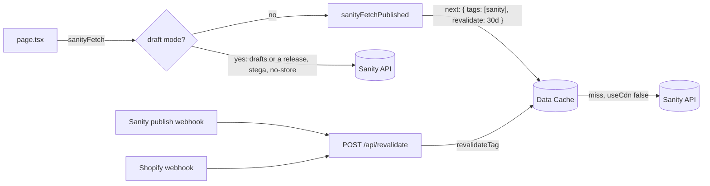

# Architecture Guide

Architectural decisions and worked patterns. The enforced rules live in AGENTS.md.

## Core Decisions

### React Compiler (No Manual Memoization)

See AGENTS.md § No manual memoization.

### CSS Modules + Tailwind

See AGENTS.md § Styling split.

### Custom Image/Link Components

Always use `@/components/ui/image` and `@/components/ui/link`, never native HTML. Image adds optimization, aspect ratios and WebGL integration; Link adds external detection, prefetching and consistent behavior.

### Lenis for Scrolling

Enabled per page through `<Wrapper lenis>` (`components/layout/wrapper/index.tsx`), which also runs anime.js on the Lenis scroll (`components/layout/lenis/anime.tsx`).

### Optional Features Pattern

`<OptionalFeatures />` (`lib/features`) in `app/(site)/layout.tsx` loads WebGL and dev tools only when needed.

### Linting and Formatting (oxc)

`oxlint` lints, `oxfmt` formats: one toolchain, one editor extension (`oxc.oxc-vscode`), one pre-commit hook. Commands are in AGENTS.md § Commands.

- **Sorting is a formatting concern, not a lint error.** `oxfmt` sorts imports and Tailwind classes on format or save, so they never fail `bun lint`.
- **One formatter for the whole repo.** Markdown, YAML and TOML are formatted alongside TS/TSX/CSS, so docs and workflows keep house style.
- **Type-aware linting.** `bun lint:types` reads the TypeScript program to catch un-awaited promises and async handlers passed where a void return is expected, which a syntax-only linter cannot see. It runs in `bun run check` and CI but not the pre-commit hook, so commits stay fast.

**Trade-off:** oxlint has no CSS parser, so there is no CSS _linting_. `oxfmt` still formats stylesheets (CSS Modules and Tailwind v4 at-rules included), except the generated `lib/styles/css/tailwind.css` and `root.css`, which are left to their generator.

Config lives in `oxlint.config.ts` and `oxfmt.config.ts`, not JSON, so `bun run typecheck` catches invalid severities and duplicate rule keys, which JSON accepts silently. Rule _names_ are a permissive `Record`, so a typo'd rule name still slips through. House style is pinned explicitly (80 columns, 2-space indent, single quotes, semicolons only where required) because oxfmt's defaults differ. Rule-by-rule list: AGENTS.md § Enforced Rules.

## Caching

`cacheComponents` is off; the rules are in AGENTS.md § Caching and § Sanity content and caching. Each integration sets its caching in its own data layer (Shopify's catalog readers, Sanity's `sanityFetchPublished`), so pages call them directly. `revalidateTag()` in `POST /api/revalidate` expires a tag and every static page whose render read it.

The trade-off is Partial Prerendering. A route that reads `params` without `generateStaticParams`, cookies or headers renders fully per request instead of streaming into a prerendered shell. Its data still comes from the Data Cache, so it costs a render, not a CMS round trip.



## WebGL Architecture

A single root canvas (`<Canvas root>`) hosts the scene; pages portal content in with `<WebGLTunnel>`. Mount it either in the root layout (lazy via `lib/features`, keeps the context alive across navigation) or per page with `<Wrapper webgl>` (remounts per route), never both. It renders only on WebGL-capable devices. See [lib/webgl/README.md](lib/webgl/README.md).

## Animation

See AGENTS.md § Animation. Directory layout: see `README.md` § Project Structure.

## Boundaries

### Validation Layer

Zod schemas validate three boundaries:

1. **Environment variables**: per-integration schemas validate config via the registry (`isConfigured()`) and `doctor.ts`
2. **Server actions**: `parseFormData()` validates FormData before processing (HubSpot, Mailchimp, Shopify)
3. **Client forms**: `zodToValidator()` bridges the same Zod schemas to the form hook's client-side validation

Env and form schemas live in `lib/utils/validation.ts`; integration-local response schemas live next to their client (`lib/integrations/hubspot/schema.ts`, `lib/integrations/shopify/schemas.ts`). `lib/env.ts` is the typed env singleton.

### Request Proxy

See AGENTS.md § Next.js 16 Request Proxy.

## Deployment Checklist

- [ ] Repository belongs to `darkroomengineering`, has a responsible team, and uses the intended default branch (normally `main`).
- [ ] Vercel project belongs to the `darkroom-engineering` team, connects to that repository, and uses the intended production branch. Run `bun run env:setup` to give it the dotenvx key (README § Environment variables); that is the only variable it needs, and the base URL comes from Vercel.
- [ ] Use the exact Bun `packageManager` pin and Node `.node-version`; pass `bun install --frozen-lockfile`, `bun run build`, and `bun run check`.
- [ ] Explicitly adopt the [shared CI and merge workflow](https://github.com/darkroomengineering/.github/blob/a75b42e03f56b5ca5b2808ac4f1b06c81998fbc6/README.md#shared-ci-components), pinned to that reviewed commit. Keep browser checks and advisories in the project; organization workflows are not inherited.
- [ ] Choose a merge policy: `actions-only` keeps application updates manual; `stable-dependencies` permits verified stable patch/minor dependency updates. Major, 0.x and prerelease updates stay manual.
- [ ] Assign security-alert review: native Bun Dependabot supports scheduled version updates, not security updates. Verify advisories and update the manifest and lockfile together for security fixes.
- [ ] Verify normal and Dependabot PR checks before requiring their observed names and app identities. Account for release and direct-push automation before enforcing branch rules.
- [ ] Make Vercel TypeCheck blocking only after it passes on a production deployment. Trigger a new deployment after changing the setting and verify its checks and promotion.
- [ ] Webhooks configured (Sanity, Shopify)
- [ ] Cache invalidation tested
- [ ] Performance score > 90

## Customization Boundaries

- **Building your project** (pages, content, styling): modify freely. `app/` is yours.
- **Extending the starter** (new shared primitives): add alongside the existing ones instead of rewriting them, so pulling satus updates stays low-conflict.

No folder rules beyond that: `components/` for UI, `lib/` for everything else.

## Code Patterns

### 1. Compound Component

UI primitives wrap `@base-ui/react` with project styling, in one of two shapes:

```tsx
// A: namespace + named exports (Accordion, Tabs)
export { Body, Button, Group, Root }
export const Accordion = { Group, Root, Button, Body }

// B: function properties (Tooltip, Checkbox, Switch)
function Tooltip({ content, children, side = 'top', className }: TooltipProps) {}
Tooltip.Root = BaseTooltip.Root
Tooltip.Popup = Popup
```

Rules: pass `className` through as `cn(s.root, className)`, spread `{...props}`, and provide both the simple and the compound API.

### 2. Context Pattern

Shared contexts (theme, cart, form) use a typed `createContext` with a `{ state, actions, meta? }` value and a hook that throws outside the provider. Reference implementation: `components/layout/theme/index.tsx`.

```tsx
const MyContext = createContext<{ state: MyState; actions: MyActions } | null>(
  null
)

function useMyComponent() {
  const context = use(MyContext)
  if (!context) throw new Error('useMyComponent must be used within MyProvider')
  return context
}
```

Component-scoped contexts may use inline `createContext` + `useContext`.

### 3. Server vs Client Split

A Server Component (no directive) fetches and passes serializable props to a Client Component. `'use client'` goes on the first line, before imports.

### 4. Integration Optionality

```tsx
import { isConfigured } from '@/integrations/registry'
import { NotConfigured } from '@/components/ui/not-configured'

if (!isConfigured('sanity')) return <NotConfigured integration="Sanity" />
```

Available checks: `isConfigured('sanity' | 'shopify' | 'hubspot' | 'mailchimp' | 'turnstile' | 'analytics')`.

Adding an integration: add its Zod schema to `@/utils/validation` and one entry to `lib/integrations/registry.ts`. `generate-manifest` and `setup:project` read the registry; `doctor` checks core env only. A removable integration also needs an `INTEGRATION_BUNDLES` entry in `lib/scripts/integration-bundles.ts` (files, deps, transforms, env stubs), or `setup:project` cannot strip it. See `lib/integrations/README.md`.

Validate external API _responses_ at the boundary, not just env config: pass untrusted upstream JSON through `parseApiResponse(schema, data, context)` (`@/utils/validation`) so a malformed response fails at the edge with context instead of crashing downstream. The Shopify, HubSpot, and Mailchimp clients do this.

### 5. WebGL Element Lifecycle

DOM-synced WebGL through the tunnel system: the page portals content into the single root canvas (see WebGL Architecture above).

```
<Canvas root> (layout OR <Wrapper webgl>) -> WebGLTunnel.Out, DOMTunnel.Out
Page -> <WebGLTunnel> (portals 3D content up into the root canvas)
```

```tsx
// DOM side: measure the element with hamo, pass the rect through the tunnel.
'use client'
import { useRect } from 'hamo'
import { WebGLTunnel } from '@/webgl/components/tunnel'

function MyWebGLComponent({ className }: { className?: string }) {
  const [setRectRef, rect] = useRect()
  return (
    <div ref={setRectRef} className={className}>
      <WebGLTunnel>
        <MyMesh rect={rect} />
      </WebGLTunnel>
    </div>
  )
}

// Canvas side: place the mesh on the rect. Runs on scroll, transform and
// re-measure events, and once after mount.
function MyMesh({ rect }: { rect: Rect }) {
  const meshRef = useRef<Mesh>(null)
  useWebGLRect(rect, ({ position, scale, isVisible }) => {
    const mesh = meshRef.current
    if (!mesh) return
    mesh.position.copy(position)
    mesh.scale.copy(scale)
    mesh.visible = isVisible
  })
  return (
    <mesh ref={meshRef} visible={false}>
      …
    </mesh>
  )
}
```

`WebGLTunnel` and `DOMTunnel` (HTML overlays) wrap `useCanvas()` internally and are the public API. Call `useCanvas()` directly only to build a new portal primitive. Always dispose GPU resources (materials, textures, geometries, render targets) on unmount.

### 6. useRef for Object Instantiation

```tsx
// Persistent instances (compiler cannot optimize class instantiation)
const instanceRef = useRef<MyClass | null>(null)
if (!instanceRef.current) {
  instanceRef.current = new MyClass()
}

// Three.js objects with cleanup
const [material] = useState(() => new MeshBasicMaterial())
useEffect(() => () => material.dispose(), [material])
```

## Extending

- **New component**: add it to `components/ui/`.
- **New integration**: see Integration Optionality above.
- **Modify styles**: edit config in `lib/styles/`, run `bun setup:styles`.
