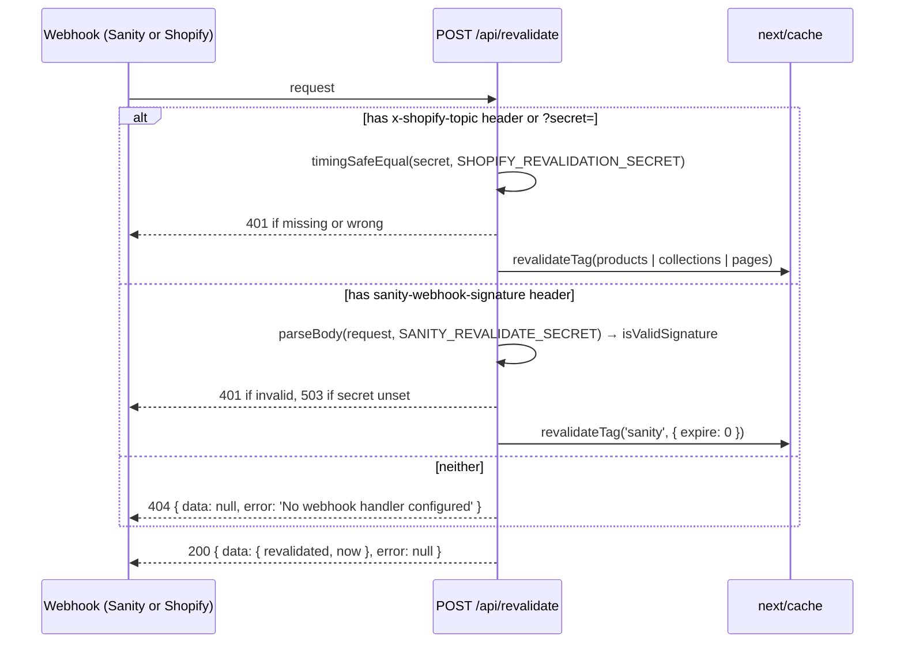

# API Routes

Server-side API endpoints for integrations and webhooks.

## Response Shape

Every JSON response is `{ data, error }`: on success `error` is `null` and
`data` holds the payload; on failure `error` is a message string and `data` is
`null` unless the endpoint documents a payload (`/api/cart/ensure` returns
`{ ready: false }`). The HTTP status carries the outcome (200 vs. 4xx/5xx); the body shape
never changes with it. A new route under `app/api/<name>/route.ts` follows the
same shape.

## Endpoints

| Route                     | Method | Purpose                                             |
| ------------------------- | ------ | --------------------------------------------------- |
| `/api/cart/ensure`        | POST   | Shopify: idempotently ensures a cart cookie exists  |
| `/api/draft-mode/enable`  | GET    | Enable Sanity draft mode                            |
| `/api/draft-mode/disable` | GET    | Disable Sanity draft mode                           |
| `/api/revalidate`         | POST   | Webhook for content revalidation (Sanity + Shopify) |

## Cart

### Ensure Cart

| Case                     | Status | Body                                                        |
| ------------------------ | ------ | ----------------------------------------------------------- |
| Shopify not configured   | 503    | `{ data: null, error: 'Shopify is not configured' }`        |
| `cartId` cookie present  | 200    | `{ data: { ready: true }, error: null }`                    |
| Cart created, cookie set | 200    | `{ data: { ready: true }, error: null }`                    |
| Cart creation failed     | 502    | `{ data: { ready: false }, error: 'Cart creation failed' }` |

The cookie is httpOnly and the cart id never reaches the client; the route
reports only presence. A 502 is non-fatal: `addItem` still creates a cart when
the cookie is missing. Clients call the route behind a cross-tab Web Lock so
only one request is in flight per browser, which stops two concurrent
first-adds from each creating a cart.

## Draft Mode

Used by Sanity Visual Editing to preview unpublished content.

### Enable Draft Mode

Sanity Studio's Presentation tool generates a signed preview link to
`/api/draft-mode/enable`, validated server-side. A hand-built request without
a valid signature returns 401 "Invalid secret". Without `SANITY_API_READ_TOKEN`
(a Viewer token, server only) the route answers 503: draft mode needs it to
read drafts.

### Disable Draft Mode

Clears draft mode cookies and redirects to the homepage.

## Revalidation Webhook

One endpoint receives both Sanity and Shopify webhooks. Each provider owns its
handler (`lib/integrations/<provider>/revalidate.ts`); the route only matches
the request to a provider and answers 404 when nothing matches.

Setup: Sanity in [lib/integrations/sanity/README.md § Revalidation](../../lib/integrations/sanity/README.md#revalidation), Shopify (including the event list) in [lib/integrations/shopify/README.md § Webhooks](../../lib/integrations/shopify/README.md#webhooks). A valid Shopify request gets 200 so Shopify does not retry.

## Security

- Webhooks require a secret (`SANITY_REVALIDATE_SECRET`,
  `SHOPIFY_REVALIDATION_SECRET`).
- Not rate limited, in the route or in `proxy.ts`, so a bulk publish is never
  turned away and the site never stays stale. A request with neither
  provider's signal gets a 404 without its body being read, and a Shopify
  secret is compared in constant time before any body read. A request with a
  Sanity signature header has its whole body read (up to the platform's
  request body cap) and HMACed before a wrong signature is rejected, with no
  wait. The cost: anyone can make the route read and hash a body that size as
  often as they like.
- Sanity: invalid signature 401, malformed body 400, unset secret 503.
- Shopify: invalid or missing secret 401 (constant-time compare).

See also: [SECURITY.md](../../SECURITY.md)
