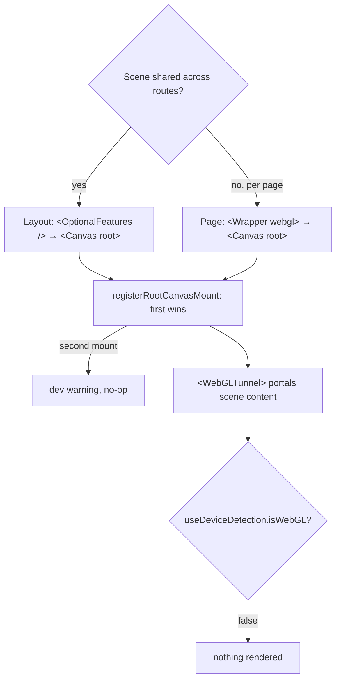

# WebGL / React Three Fiber

WebGL 2-accelerated 3D rendering with a persistent root canvas, built on
`@react-three/fiber`'s `WebGLRenderer`. GPU simulations (fluid, flowmap) run
as GLSL3 `RawShaderMaterial` passes.

## Quick Start

```tsx
import { Wrapper } from '@/components/layout/wrapper'
import { WebGLTunnel } from '@/webgl/components/tunnel'

export default function Page() {
  return (
    <Wrapper>
      <WebGLTunnel>
        <My3DScene />
      </WebGLTunnel>
      <section>HTML overlay</section>
    </Wrapper>
  )
}
```

A worked example lives at `app/(site)/(examples)/webgl` (`/webgl` in dev):
cubes that take their size and place from boxes CSS lays out, hold them
through scroll and resize, and follow a parallax transform published through
hamo's `TransformProvider`. Contributor-facing, noindex, and deleted by
`setup:project` with the rest of the examples group.

The canvas is mounted with `<Canvas root>`, either once in the shared layout
(`lib/features`: `<OptionalFeatures />` mounts it unconditionally) so it
persists across route navigation, or per page by passing `webgl` to the
Wrapper (`<Wrapper webgl>`) after removing it from the layout.
Pick exactly one — the store enforces a single root canvas at runtime, so if
both are mounted the first one wins and the second is a no-op (with a dev
warning), not a second canvas eating GPU.



### Perf: opting into GPU simulations

`<Canvas root>` mounts `FlowmapProvider` with no GPU simulations by default —
mounting a sim without a consumer wastes a render pass and window listeners.
Pass `simTypes` with the sims you actually use:

```tsx
<Canvas root simTypes={['flowmap']} />
```

## Device gating

The canvas is rendered only when `useDeviceDetection().isWebGL` is true (a
hardware-accelerated WebGL2 context on a desktop viewport that is not
touch-only) AND the user does not prefer reduced motion. On mobile, phones in
landscape, tablets, unsupported devices, or under
`prefers-reduced-motion` it's a no-op — nothing mounts. Rendering is driven
manually by the `RAF` component (`frameloop="never"`), not the default r3f
render loop.

> **Always ship a fallback.** Because reduced-motion (and non-WebGL devices)
> means the canvas may never mount, any page that puts _content_ in WebGL —
> not just decoration — must render a non-WebGL fallback (static image, DOM
> equivalent) for that state. If the WebGL content is essential and motionless,
> mount with `force` and damp motion inside the scene instead.

## When the canvas draws

The canvas draws only while something changed (`lib/webgl/utils/awake.ts`).
An idle page keeps its last picture on screen and spends no GPU time. Two
signals keep it drawing:

- **`wake(ms = 2000)`**, a nudge: drawing continues for a grace window so
  short eases finish. These already wake it: a `useWebGLRect` placement that
  moved, resized, showed or hid its element (scroll, resize, re-measure,
  `TransformProvider` translate); a texture loading in `Image`; a canvas
  resize or pixel-ratio change; a WebGL context restore; tunnel content
  mounting, unmounting or re-rendering.
- **`useHoldAwake(active)`** (or `useLease()` for imperative acquire and release),
  a lease for anything that changes every frame. The flowmap and fluid sims
  take one after each pointer move and release it once the trail has faded
  below 1%.

A scene that animates on its own, such as a `useFrame` spin or a time
uniform, freezes once the grace window ends unless it holds the canvas:

```tsx
import { useFrame } from '@react-three/fiber'
import { useHoldAwake } from '@/webgl/utils/awake'

function Spinner({ isVisible }: { isVisible: boolean }) {
  useHoldAwake(isVisible)
  useFrame(({ clock }) => {
    // …
  })
}
```

The `/webgl` cube takes a `useLease()` hold from its `useWebGLRect` callback
instead, so its visibility never becomes React state. State held inside the
canvas that changes the picture without moving through the tunnel (a
material color set from a canvas-side `useState`) calls `wake()` itself.

`<Canvas root render="always">` draws every frame, which is useful for
ruling out a missed wake while debugging; `render={false}` never draws.

## Pixel ratio

`WebGLCanvas` (`lib/webgl/components/canvas/webgl.tsx`) owns the canvas DPR
through r3f's `dpr` prop. Nothing else calls `setDpr`: r3f overwrites it with
the prop on the next render. The prop is a range, `[1, max]`, so r3f clamps
`devicePixelRatio` into it and follows the display when the window moves to
another screen or zooms. `max` is 2, or 1 when postprocessing is on and the
window is wider than 2048 CSS px.

`max` adapts to the device. drei's `PerformanceMonitor` steps it down by 0.25
on sustained frame drops (fps under 40 on a 60 Hz display) and back up on
recovery, never below 1: the planes stand in for DOM images and text, and
under 1 device pixel per CSS pixel they look blurrier than the page around
them. It decides from 10 samples of 250 ms of continuous drawing and starts
over each time the canvas stops drawing, so idle time never counts as slow
frames and a single 2 s `wake()` never changes the DPR; scrolling or a hold
can. On its third change of direction it settles on the lower DPR and stops,
so a device sitting on a threshold doesn't keep resizing the canvas. A DPR
change wakes the canvas.

## Architecture

```
<Canvas root> (layout OR per-page Wrapper) → rendered only when isWebGL
    └─ WebGLTunnel.Out (portals 3D content from any page)
```

**Key benefits (shared/layout strategy):**

- Context persists across navigation (no recreation)
- Seamless route transitions
- Shared assets stay loaded while anything on the page uses them
- No-op on non-WebGL devices

## Components

| Component     | Purpose                                                   |
| ------------- | --------------------------------------------------------- |
| `Canvas`      | Mounts the canvas via `root` (layout or per-page Wrapper) |
| `WebGLTunnel` | Portal 3D content into the canvas                         |
| `DOMTunnel`   | Portal HTML overlays                                      |

`Image` (`@/webgl/components/image`) draws a DOM image as a textured plane.
A texture is read with a CORS request, so the image host has to allow the
page's origin. When it doesn't, the plane never mounts and the DOM image
stays visible. For Sanity images that means every origin the site is served
from, production domains and a wildcard for preview deploys
(`https://*.vercel.app`), must be in the Sanity project's CORS origins
(manage.sanity.io > API > CORS origins); Sanity's CDN answers any other
origin with a 403.

Planes with the same `src` share one texture from drei's `useTexture` cache.
`Image` counts the planes using each texture; 5 s after the last one
unmounts, it clears the texture from the cache and frees its GPU memory, so
navigating between pages doesn't pile up textures on the persistent canvas.
The delay lets the next page reuse a shared image: its plane mounts only
after its DOM image loads, and without the delay the shared texture would be
decoded and uploaded again on every navigation. A page that comes back after
that loads the image again (usually from the HTTP cache). Image
textures use mipmaps with trilinear filtering and up to 4x anisotropy, so a
plane drawn smaller than its source doesn't shimmer as it scrolls.

## Hooks

```tsx
import { useRect } from 'hamo'
import { useDeviceDetection } from '@/hooks/use-device-detection'
import { useWebGLRect } from '@/webgl/hooks/use-webgl-rect'

// DOM side: measure the element once per resize (hamo), pass the rect down.
const [setRectRef, rect] = useRect({ ignoreTransform: true })

// Canvas side: place a mesh on it, on Lenis scroll events, provider
// transform changes and re-measures.
useWebGLRect(rect, onUpdate)

// Gate rendering on capability
const { isWebGL } = useDeviceDetection()
```

`onUpdate` receives `{ position, scale, isVisible }` in the camera's units
(one unit per CSS pixel, origin mid-screen). Pass `ignoreTransform` to
`useRect` for an element that moves under a `TransformProvider`, whose
translate the hook adds itself. The hook works on either side of the tunnel:
in the mesh component its render effect places the mesh as soon as it
mounts; on the DOM side, where the mesh can mount later, the returned
`update` goes in the mesh's ref callback.

## DOM-Synced Component

```tsx
import { type Rect, useRect } from 'hamo'
import { useRef } from 'react'
import type { Mesh } from 'three'
import { useWebGLRect } from '@/webgl/hooks/use-webgl-rect'
import { WebGLTunnel } from '@/webgl/components/tunnel'

function WebGLBox({ className }) {
  const [setRectRef, rect] = useRect()
  return (
    <div ref={setRectRef} className={className}>
      <WebGLTunnel>
        <BoxMesh rect={rect} />
      </WebGLTunnel>
    </div>
  )
}

function BoxMesh({ rect }: { rect: Rect }) {
  const meshRef = useRef<Mesh>(null)
  useWebGLRect(rect, ({ position, scale, isVisible }) => {
    const mesh = meshRef.current
    if (!mesh) return
    mesh.position.copy(position)
    mesh.scale.copy(scale)
    mesh.visible = isVisible
  })
  return (
    <mesh ref={meshRef} visible={false}>
      <planeGeometry />
      <meshBasicMaterial />
    </mesh>
  )
}
```
